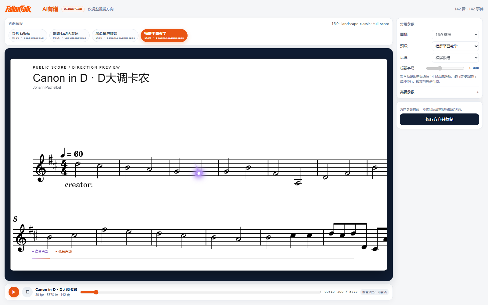
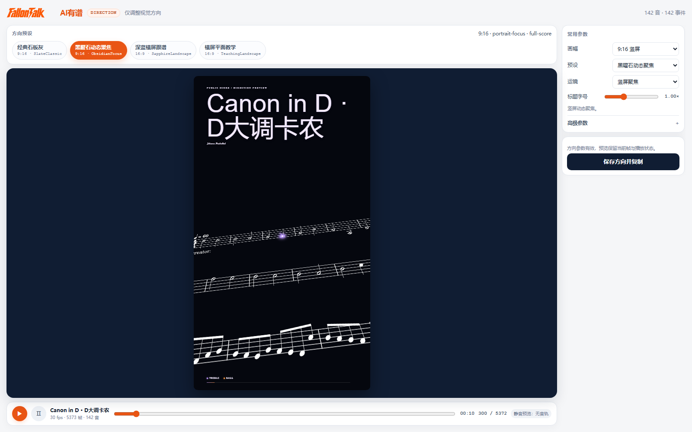

<div align="center">

# 🎹 AI有谱

**让乐谱随音乐跳起来。**

把钢琴乐谱变成带有音符跳跃、发光轨迹和跟谱镜头的视频。

[观看效果](#成品展示) · [工作台预览](#可选工作台先看效果再定方向) · [开始使用](#快速开始) · [使用指南](README_使用说明.md)

</div>


## 能帮你做什么

- **制作钢琴跟谱视频**：左右手用不同颜色呈现，光点随音符跳动，和弦一起亮起。
- **选择喜欢的画面**：支持横屏、竖屏，以及适合教学、练习分享和音乐欣赏的不同风格。
- **使用自己的演奏录音**：有对应录音就保留原演奏；没有录音，可以让 Agent 根据乐谱准备钢琴配乐。
- **先看效果，再做视频**：确认谱面后，先看画面和试听，再继续制作。

你可以在 Codex、WorkBuddy 等支持 Skill 的 Agent 中使用 AI有谱。告诉 Agent 你有什么素材、想要什么效果，它会按步骤协助你完成。

## 成品展示

[](https://v.douyin.com/UzgL2_wsNRY/)

**点击封面观看《La La Land · 爱乐之城》示例视频。** 紫色与橙色光点跟随双手演奏，在和弦之间分开、汇聚，镜头随谱面前进。

### 更多画面效果


同一首作品可以选择不同的背景、构图和镜头风格。

## 可选工作台：先看效果，再定方向

想直观看效果时，可以打开工作台，选择预设、调整构图并预览动效。



**选好后，点击「保存方向并复制」，把提示词粘贴回 Agent，继续制作。**

<details>
<summary>查看竖屏方向预览</summary>



</details>

工作台是可选的。你也可以直接告诉 Agent 想要的风格，全程在对话中完成。没有提供音频时，工作台会以静音方式预览画面。

截图示例曲目为《Canon in D》。谱面来源：[Mutopia Project](https://www.mutopiaproject.org/ftp/PachelbelJ/CanonInD/)，CC BY 3.0；详见[样本来源](workbench/canon-public-test/sources.json)。

## 快速开始

1. 从[下载页](https://github.com/Fallonwong/aiyoupu/releases/tag/v2.3.1)下载 `aiyoupu-2.3.1.zip`。
2. 解压后，将 `aiyoupu` 文件夹放入所用 Agent 的 Skill 目录。不同 Agent 的安装位置见[使用指南](README_使用说明.md)。
3. 开启新对话，提供素材，并告诉 Agent：

```text
使用 $aiyoupu，帮我制作一段钢琴跟谱视频。
素材：<你的乐谱和录音路径>。
想要的效果：<横屏或竖屏、喜欢的风格>。
先让我确认谱面，再看画面和试听。
```

第一次使用，建议先用一小段乐谱体验。如果已经安装过旧版，先保留原目录和作品资料，再单独安装新版。

## 准备什么素材

| 你手上的素材 | 怎样开始 |
| --- | --- |
| **MusicXML 乐谱** | 最方便开始。可以根据这份乐谱准备钢琴配乐。 |
| **MusicXML + 对应录音** | 想保留自己的演奏，推荐这组。乐谱和录音应是同一个版本、同一个选段。 |
| **MIDI** | 可以使用，先告诉 Agent 左右手或声部怎样分配。 |
| **PDF / 五线谱图片** | 可以使用，需要先识别并校对谱面；图片要清晰、完整。 |
| **简谱图片** | 先确认调号、八度、节奏和连线，再整理成乐谱。 |
| **只有 MP3** | 建议再补充对应乐谱。AI有谱目前不能仅凭录音直接恢复完整、准确的双手乐谱。 |

不用一次准备所有格式。先把已有素材交给 Agent，它会说明还需要补什么。涉及额外工具或音源时，会先说明。

## 从素材到视频

1. **提供素材**：告诉 Agent 曲名、选段和想要的效果。
2. **确认谱面**：检查音符、节奏、左右手和连线，有问题先修改。
3. **选择画面，听一听**：在对话或工作台中确定方向，再查看实际画面和试听。
4. **生成视频**：确认满意后，继续输出 MP4。

想修改时，直接指出具体小节、画面位置或听到的问题，不需要重新描述整个任务。


## 更新记录

**v2.3.1（2026-11-13）**

- 修复同一谱行跨小节时，紫色光点停在原处、随后突然出现在新音上的问题。现在会沿弧线越过小节线，落到新弹的符头上；延音不重击，休止保持安静。

**v2.3.0（2026-11-13）**

- 同一行跟谱时，镜头不会在每次击键时反复减速。换行距离太远时，谱面会短暂淡切到下一行，音符和声音的时序不变。
- 光点按实际符头落下，换行后首个新音完整亮起；延音和休止遵循原谱。
- 方向预览准备好后，Agent 会提示你说「打开工作台」，可以边播放边看效果、切换风格。

**v2.2.0（2026-11-13）**

- 修正运镜卡顿：镜头原来只在音符出现时移动一下，两个音符之间保持不动，播放起来像翻页。现在改为逐帧连续移动，音符落点位置不变。
- 新增检查：制作前会先确认镜头是否是连续运动，不合格的镜头不会进入正式出片。
- 升级方法：备份原文件夹和作品资料，下载新包替换。已有工程不用重建。

**v2.1.0（2026-11-08）**

- 正式更名为 AI有谱，命令与目录统一为 `aiyoupu`。
- 新增方向工作台，可以先看效果再定风格。
## 常见问题

**必须打开工作台吗？**

不用。工作台方便直观看效果，所有制作步骤也可以由 Agent 在对话中完成。

**没有录音怎么办？**

可以根据校对后的乐谱，使用已有钢琴音源准备配乐，先试听再决定。

**PDF 或图片能直接变成视频吗？**

需要先识谱和校对。识别结果可能有错，确认音符和节奏后再制作更稳妥。

**延音线后面的音符还会再跳一次吗？**

同音延音的后半段不重复起跳；圆滑线连接的不同音符仍各自起音。

**能修改已经选好的风格吗？**

可以。告诉 Agent 要改哪里，再查看更新后的画面和试听。

---

[使用指南](README_使用说明.md) · [开发与技术参考](DEVELOPMENT.md) · [许可说明](history/v130/LICENSE.txt)
